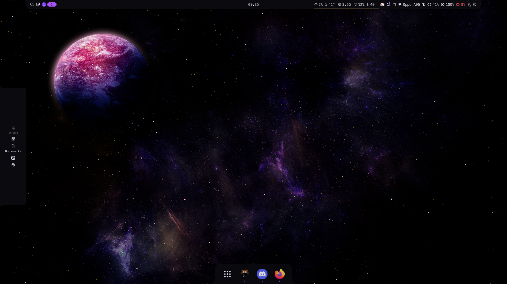

# dotfiles

My tiny rice: **Hyprland** (Lua config) with the **Noctalia** shell, in a purple *VoidViolet* theme.
Managed with [GNU Stow](https://www.gnu.org/software/stow/), built for Arch / CachyOS.



## What's inside

| Package       | What it configures                                              |
| ------------- | --------------------------------------------------------------- |
| `hypr`        | Hyprland, written in the new Lua config format (0.55+)          |
| `noctalia`    | Noctalia shell: bar, launcher, notifications, color palettes    |
| `kitty`       | Terminal, with splits and tab shortcuts                         |
| `zsh`         | zsh + oh-my-zsh + powerlevel10k, aliases, auto-notify           |
| `nvim`        | LazyVim                                                         |
| `qt6ct`       | Qt theming, so Dolphin and friends follow the Noctalia colors   |
| `applications`| Desktop entries (gives the dropdown terminal its icon)          |

## Install

```bash
git clone https://github.com/sarxzer/dotfiles ~/dotfiles
cd ~/dotfiles
./install.sh
```

The script installs the packages, oh-my-zsh and its plugins, then links everything with Stow.
Anything that would be overwritten is moved to `~/.dotfiles-backup/` first, and it's safe to re-run.
Use `./install.sh --skip-packages` to only clone plugins and link the configs.

To link a single package by hand: `stow hypr` (run from the repo folder).

## Keybinds

`Super` is the main modifier. Press **Super + F1** for the full cheat sheet.

| Keys                | Action                       |
| ------------------- | ---------------------------- |
| `Super + Space`     | Launcher                     |
| `Super + Q`         | Terminal                     |
| `Super + F12`       | Dropdown terminal            |
| `Super + F`         | Fullscreen                   |
| `Super + R`         | Resize mode (`Esc` to leave) |
| `Super + 1..0`      | Go to workspace              |
| `Super + Shift + 1..0` | Move window to workspace  |

Workspace binds use keycodes, so they work the same on QWERTY and AZERTY.

## Keeping machines in sync

```bash
git pull --rebase --autostash     # on the other machine
./install.sh --skip-packages      # only needed after adding a new file or package
```

## Credits

[Hyprland](https://hypr.land) · [Noctalia](https://docs.noctalia.dev) · [oh-my-zsh](https://ohmyz.sh) · [powerlevel10k](https://github.com/romkatv/powerlevel10k) · [LazyVim](https://www.lazyvim.org) · [zsh-auto-notify](https://github.com/MichaelAquilina/zsh-auto-notify)
